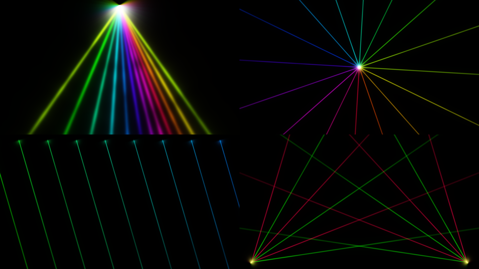
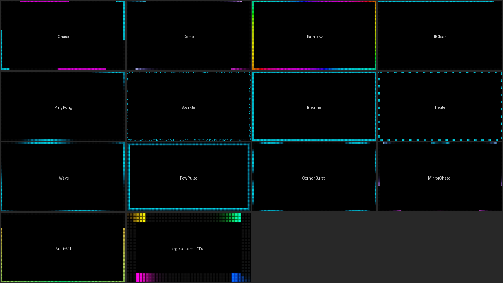

# Plugin FFGL cho Resolume: Laser Beams + LED Border

Hai plugin **Source** cho Resolume Avenue / Arena 7.3.1 trở lên, chạy được trên **Windows** và **macOS** (Intel + Apple Silicon):

- **Laser Beams** – tia laser phát sáng
- **LED Border** – viền LED chạy quanh khung hình, mô phỏng bảng LED matrix

---

# Laser Beams



## Tính năng

- 4 kiểu tia: **Fan** (quạt), **Starburst** (toả tròn), **Parallel Scan** (hàng tia song song), **Crossfire** (hai quạt bắn chéo)
- 1–32 tia, quét qua lại, hiệu ứng sóng giữa các tia
- **BPM Sync**: khoá chuyển động và strobe theo nhịp của Resolume
- Glow, khói (haze), độ dài tia, độ rộng tia
- 4 chế độ màu: một màu, xen kẽ 2 màu, chuyển màu, cầu vồng
- Strobe, **Audio React** (tia sáng/dày lên theo tiếng bass)
- **Pattern Change / Color Change**: tự đổi kiểu tia và đổi màu theo bar, theo beat hoặc theo tiếng kick
- Nền trong suốt để chồng lên các layer khác

## Thông số

| Nhóm | Thông số | Ý nghĩa |
|---|---|---|
| Shape & Motion | Pattern | Kiểu tia |
| | Beams | Số tia (1–32) |
| | Spread | Độ xoè của quạt / khoảng cách giữa các tia song song |
| | Wave | Lệch pha giữa các tia → tia chuyển động như sóng |
| | Sweep | Biên độ quét |
| | Speed | Tốc độ quét. Khi bật BPM Sync: 1 lần/4 bar → 4 lần/bar |
| | BPM Sync | Đồng bộ theo BPM của Resolume |
| | Rotation | Xoay hướng tia (−180°…180°) |
| | Origin X / Y | Vị trí nguồn phát |
| Look | Width, Glow, Haze, Length, Intensity | Độ dày, độ toả sáng, khói, độ dài, độ sáng tổng |
| Color | Color Mode, Color 1, Color 2 | Chế độ màu và hai màu chọn |
| FX | Strobe | Nháy. Khi BPM Sync: nốt 1/4 → 1/32 |
| | Audio React | Mức phản ứng với âm thanh (dùng FFT của Resolume) |
| | Transparent BG | Nền trong suốt |
| Music | Pattern Change | Tự đổi sang kiểu tia khác: Off / Every Bar / Every Beat / On Kick |
| | Color Change | Tự nhảy màu: Off / Every Bar / Every Beat / On Kick |

---

# LED Border



Viền LED chạy quanh mép màn hình. Mỗi bóng LED được vẽ riêng (tròn / vuông / pixel), bóng tắt vẫn hơi xám như bảng LED thật. Nền trong suốt nên đặt lên trên mọi layer video.

## 13 hiệu ứng

| Hiệu ứng | Mô tả |
|---|---|
| Chase | Các đoạn sáng chạy vòng quanh viền |
| Comet | Sao chổi có đuôi mờ dần |
| Rainbow Flow | Dải cầu vồng chảy quanh viền |
| Fill & Clear | Viền sáng dần cho đầy rồi tắt dần |
| Ping-Pong | Hai điểm sáng chạy qua lại, giao nhau |
| Sparkle | LED lấp lánh ngẫu nhiên |
| Breathe | Cả viền sáng – tối nhịp nhàng |
| Theater | Kiểu đèn rạp hát (marquee) chạy từng nấc |
| Wave | Sóng sáng chạy quanh viền |
| Row Pulse | Các hàng LED sáng lần lượt từ ngoài vào trong (tăng *Rows*) |
| Corner Burst | Bung ra từ 4 góc (bật *Reverse* để thu vào góc) |
| Mirror Chase | Sao chổi chạy từ giữa cạnh trên xuống hai bên, đối xứng |
| Audio VU | Đồng hồ âm lượng: viền dâng lên từ giữa cạnh dưới theo nhạc |

## Thông số

| Nhóm | Thông số | Ý nghĩa |
|---|---|---|
| Effect | Effect | Chọn hiệu ứng |
| | Speed | Tốc độ. Khi bật BPM Sync: 1 vòng/4 bar → 4 vòng/bar |
| | BPM Sync | Đồng bộ theo BPM của Resolume |
| | Reverse | Đảo chiều chạy |
| | Segments | Số đoạn / số sao chổi (1–16) |
| | Length | Độ dài đoạn sáng, đuôi sao chổi, mật độ lấp lánh |
| | Sides | Chạy cả 4 cạnh, chỉ trên + dưới, chỉ trái + phải, chỉ trên, chỉ dưới |
| LED Matrix | Rows | Số hàng LED của viền (1–8) |
| | LED Size | Kích thước bóng LED (nhỏ = nhiều bóng hơn) |
| | LED Shape | Round / Square / Pixel |
| | Gap | Khoảng hở giữa các bóng |
| | Glow | Quầng sáng quanh bóng |
| | Unlit LEDs | Độ hiện của bóng đang tắt (0 = ẩn hẳn) |
| Color | Color Mode, Color 1, Color 2, Intensity | Một màu / xen kẽ / chuyển màu / cầu vồng, độ sáng |
| Music & FX | Strobe | Nháy. Khi BPM Sync: nốt 1/4 → 1/32 |
| | Audio React | Sáng mạnh lên theo tiếng bass |
| | Effect Change | Tự đổi hiệu ứng: Off / Every Bar / Every Beat / On Kick |
| | Color Change | Tự nhảy màu: Off / Every Bar / Every Beat / On Kick |
| | Transparent BG | Nền trong suốt |

Gợi ý: *Effect Change = Every Bar* + *Color Change = On Kick* + *BPM Sync* bật là có một màn viền tự chạy theo nhạc. Audio VU không nằm trong danh sách tự đổi; muốn dùng thì chọn trực tiếp.

---

Mọi thông số của cả hai plugin đều map được với MIDI/OSC và các dashboard của Resolume như plugin bình thường.

## Cách build

### Cách 1 – Dễ nhất, không cần cài gì (GitHub Actions)

1. Tạo một repository trên GitHub và upload toàn bộ thư mục này lên (giữ nguyên thư mục `.github`).
2. Vào tab **Actions** → workflow **Build Resolume plugins** sẽ tự chạy (hoặc bấm **Run workflow**).
3. Khi chạy xong (~3–5 phút), tải ở mục **Artifacts**:
   - `Plugins-Windows` → `LaserBeams.dll`, `LedBorder.dll`
   - `Plugins-macOS` → `LaserBeams-macOS.zip`, `LedBorder-macOS.zip` (giải nén ra file `.bundle`)

### Cách 2 – Build trên Windows

Cần: Visual Studio 2022 (workload *Desktop development with C++*), CMake, Git.

```bat
cmake -B build -A x64
cmake --build build --config Release
```
Kết quả: `build\out\LaserBeams.dll` và `build\out\LedBorder.dll`

### Cách 3 – Build trên macOS

Cần: Xcode Command Line Tools (`xcode-select --install`), CMake (`brew install cmake`).

```bash
cmake -B build -DCMAKE_BUILD_TYPE=Release
cmake --build build
codesign --force --deep -s - build/out/LaserBeams.bundle
codesign --force --deep -s - build/out/LedBorder.bundle
```
Kết quả: `build/out/LaserBeams.bundle` và `build/out/LedBorder.bundle` (universal, chạy được cả Mac M1/M2/M3 và Intel)

> CMake tự tải FFGL SDK chính thức của Resolume khi build, bạn không cần tải riêng.

## Cài vào Resolume

1. Copy các file `.dll` (Windows) hoặc `.bundle` (macOS) vào thư mục **Extra Effects** của Resolume, thường là
   `Documents/Resolume Arena/Extra Effects` (hoặc `Documents/Resolume Avenue/Extra Effects`).
   Nếu chưa chắc, mở **Preferences → Video** trong Resolume để xem/thêm thư mục plugin.
2. Khởi động lại Resolume.
3. Tìm **Laser Beams** / **LED Border** trong tab **Sources** và kéo vào một clip.

**macOS:** nếu bundle tải từ Internet bị chặn, chạy lệnh sau rồi mở lại Resolume:
```bash
xattr -cr ~/Documents/Resolume\ Arena/Extra\ Effects/*.bundle
```

**Chạy theo nhạc:**
- *Every Bar / Every Beat* dùng nhịp BPM của Resolume (tính theo nhịp 4/4), nên cần đặt BPM đúng (tap tempo, Ableton Link hoặc MIDI Clock) và transport đang chạy.
- *On Kick* nghe trực tiếp tiếng bass từ âm thanh, không cần BPM. Mỗi lần đổi cách nhau tối thiểu ~0,2 giây.
- Kiểu tia (*Pattern*) hoặc hiệu ứng (*Effect*) đang chọn là điểm bắt đầu; đặt *Pattern Change* / *Effect Change* về Off để quay lại đúng lựa chọn đó. Tương tự, tắt *Color Change* để về màu gốc.
- Nếu phát file mp3 trong Resolume, chọn nguồn FFT là **Composition FFT** (hoặc Layer FFT của layer nhạc) để On Kick, Audio React và Audio VU nghe đúng bài.

**Audio React:** chọn nguồn âm thanh cho clip trong Resolume (Audio FFT), sau đó tăng thông số *Audio React*.

## Tuỳ biến

Hình ảnh của mỗi plugin nằm trong shader GLSL (biến `fragmentShaderCode`) ở `source/LaserBeams.cpp` và `source/LedBorder.cpp`.
- Thêm kiểu tia laser: thêm nhánh `uPattern == 4` trong `main()` và một mục `SetParamElementInfo( PT_PATTERN, ... )`.
- Thêm hiệu ứng viền: thêm nhánh `uEffect == 13`, thêm tên vào `EFFECT_NAMES` và tăng `NUM_EFFECTS`.

Lưu ý: đây là các hiệu ứng **hình ảnh** (cho màn hình/LED/máy chiếu), không xuất tín hiệu ra máy laser thật.
